# Exact Federated Preprocessing for Linear DDoS Detection in IoT: What Shared Statistics Buy Under Non-IID Clients

*Authors: [Author Name 1], [Author Name 2] — [Department, Institution, City, Country]* (placeholders)

## Abstract

Federated learning lets IoT gateways train DDoS detectors without pooling traffic, yet a recent lightweight pipeline fits its feature selection and scaling on pooled, pre-split data, which contradicts data locality. We audit that pipeline, reproduce it on real CIC-IoT2023 flows, and propose FedStat-FS: variance filtering, Pearson and LDA selection, their intersection and global standardisation are computed exactly from two additive uploads per client, and a linear SVM is trained with warm-start FedAvg. On CIC-IoT2023 and N-BaIoT (10 seeds, identically tuned baselines, test data used once) the federated subset equalled the pooled one in 60 of 60 runs. Under Dirichlet(0.1) label skew, naive local preprocessing fell to F1 0.5754 while FedStat-FS kept 0.9913; ablations attribute the gap to global standardisation, not to selection. Pooled pre-split preprocessing showed no measurable optimism. The Pearson–LDA intersection, however, brought no accuracy benefit and made linear detectors fail in 4 of 20 N-BaIoT runs, whereas Pearson-only never failed. The statistics exchange costs 33.8 KB per client, once.

**Keywords:** federated learning, intrusion detection, DDoS, Internet of Things, feature selection, non-IID data

## Introduction

DDoS floods are among the most damaging threats to IoT deployments, and federated learning (FL) [mcmahan2017; kairouz2021] lets gateways train a shared detector without pooling traffic. Karunamurthy et al. pair a chimp-optimisation feature-selection wrapper with a federated CNN on MQTTset [karunamurthy2025]; a follow-up (the “senior” work) replaces both by a Pearson–LDA intersection filter and a federated linear SVM [cortes1995] on CIC-IoT2023 [senior2026], a lightweight design aimed at constrained gateways.

Our audit (Section the referenced section) shows that its privacy argument stops at the model: the variance filter, Pearson and LDA selectors and the scaler are fitted on *pooled* data *before* the train/test split, so raw flows must be centralised and test statistics leak; the “rounds” retrain every worker from scratch (one-shot averaging); and duplicate flows can straddle the split. Federated preprocessing has been studied only in pieces: StatAvg shares client feature means and variances to normalise deep FL-IDS models [bouzinis2025], and chi-square or mutual-information selection has been paired with deep models [nguyen2026; fdids2025]. To the best of our knowledge, no work derives a hybrid Pearson-and-LDA subset *and* global standardisation exactly from additive client statistics for a linear detector, quantifies what pooled pre-split preprocessing leaks, and tests naive local alternatives under non-IID clients. We ask:

- **RQ1.** Can the selection and standardisation be computed exactly from additive client statistics, and how much optimism does pooled pre-split preprocessing add over a leakage-free protocol?

- **RQ2.** How much do naive local preprocessing pipelines lose, versus federated-statistics preprocessing, as clients become non-IID?

- **RQ3.** What does the statistics exchange cost, and does the lightweight detector stay competitive with a federated MLP, FedProx and a centralised random forest?

**Contributions.** (1) A reproduction and audit of the senior pipeline on real CIC-IoT2023 flows (twelve defects). (2) *FedStat-FS*, which extends StatAvg from normalisation to the whole preprocessing stage, followed by warm-start FedAvg of a TensorFlow linear SVM. (3) A leakage-free, de-duplicated, ten-seed protocol with identical tuning budgets on two real datasets, one with a natural per-device federation. (4) Empirical findings, including negative ones.

## Related Work

**Federated IDS.** A survey [agrawal2022] documents the uptake of FL-IDS; FLAD proposes adaptive federated learning for DDoS detection [doriguzzi2024]. Devine et al. train a federated SVM on IoT DDoS data with a dedicated data-preparation stage [devine2025].
**Non-IID clients.** Label-skew partitions are commonly drawn from Dirichlet priors [hsu2019]; FedProx adds a proximal term against client drift [li2020fedprox]. FL-IDS variants use knowledge distillation with a proximal term [fdids2025], dynamic weighted clustering [fedDWC2025] and multi-dataset benchmarks of FedAvg/FedProx/FedNova [datasetcentric2026]; most change the optimiser or model, not the preprocessing.
**Selection and statistics sharing.** Filter selection for IDS is classical [ambusaidi2016]; federated variants use greedy per-attack selection [yang2021], chi-square with a GRU [nguyen2026] or mutual information [fdids2025]. StatAvg [bouzinis2025] shares per-feature means and variances so that all clients normalise identically, reporting accuracy gains of 4–17% over normalisation-based baselines such as FedBN. We keep its principle but share per-class second moments, which suffice for Pearson and LDA.
**Evaluation pitfalls.** Preprocessing fitted before splitting and duplicates are recurrent sources of optimism in ML-based security [arp2022; kapoor2023]. Table I (also I) compares the closest methods and quotes their results (not directly comparable).

**Table I.** Related-work comparison and reported results (as far as the cited abstracts/papers state; “part” = partial or not stated). Reported numbers are quoted from each source; datasets, splits and metrics differ, so rows are not directly comparable.

| Method | Dataset(s) | Model | Selection | Fed. | Non-IID | Fed. prep. stats | Leakage-free audit | Reported result (quoted) |
|—|—|—|—|—|—|—|—|—|
| Karunamurthy et al. [karunamurthy2025] | MQTTset | CNN | wrapper (COA) | yes | no | no | no | acc. 95.59%, macro-F1 94.04% |
| Devine et al. [devine2025] | IoT DDoS data | SVM/RF/ANN | data preparation | yes | no | no | part | not stated in abstract |
| Yang & Kondo [yang2021] | NSL-KDD | on-device NN | greedy per attack | yes | no | no | no | not stated in abstract |
| FD-IDS [fdids2025] | Edge-IIoT, N-BaIoT | NN + KD + prox | mutual information | yes | yes | no | no | not stated in abstract |
| StatAvg [bouzinis2025] | TON-IoT, CIC-IoT-2023 | deep FL | – (normalisation) | yes | yes | part | no | acc. gain 4–17% over normalisation baselines |
| Fed-FeRe [nguyen2026] | IoT IDS data | GRU | chi-square | yes | yes | no | no | +3.06% precision, $\approx$2% less traffic than FedAvg |
| FedDWC [fedDWC2025] | IoTID20 | clustered FL | – | yes | yes | no | no | acc. +1.9/+1.31/+1.01% over FedAvg/FedProx/IFCA |
| Senior [senior2026] | CIC-IoT2023 | linear SVM | Pearson$\cap$LDA | yes | no | no | no | F1 98.81% (99.66% in our re-run) |
| FedStat-FS (ours) | CIC-IoT2023, N-BaIoT | linear SVM (+MLP/prox baselines) | Pearson$\cap$LDA, exact | yes | yes | yes | yes | Table IV |

## Audit of the Senior Pipeline and Proposed Method

### Reproduction and audit

We ran the released scikit-learn code unchanged on a random sample of real CIC-IoT2023 flows (255,000 benign, 245,000 DDoS, as in [senior2026]). The qualitative claims reproduce (17 of 46 features kept; federated equals centralised; Isolation Forest fails, F1 0.1974); our federated-SVM F1 is 0.9966 against the reported 0.9881, plausibly because the released loader keeps the first rows it meets rather than a random draw. TensorFlow ports of the SVM (F1 0.9969 hinge, 0.9966 squared hinge) and of the MLP (0.9977) match scikit-learn (0.9963, 0.9987). The audit found four defects that matter for a privacy claim (eight more are in the project's analysis file):

- **Pooled, pre-split preprocessing:** variance filter, Pearson, LDA and scaler are fitted on all rows before `train_test_split`.

- **One-shot averaging:** each “round” builds a fresh `LinearSVC` per worker; the global model is never sent back.

- **Centralised baselines:** RF, ANN and Isolation Forest are trained centrally although described as federated.

- **Loss and duplicates:** squared hinge is used although [senior2026] lists hinge; 4.7% of a random sample of the release are exact duplicates that a random split spreads over train and test.

### Problem formulation

Client $k\in\{1..K\}$ holds $D_k=\{(x_i,y_i)\}$, $x_i\in\mathrm{R}^d$, $y_i\in\{0,1\}$ (1 = DDoS), $n_k=|D_k|$, $n=\sum_k n_k$. With $\phi(x)=(x_F-m)/s$ (keep features $F$, standardise) and $f_\theta(z)=w^\top z+b$, the goal is

$$
\min_\theta F(\theta)=\sum_{k=1}^{K}\frac{n_k}{n}F_k(\theta),

F_k(\theta)=\frac1{n_k}\sum_{i\in D_k}\ell\big(y_i,f_\theta(\phi(x_i))\big)+\frac{\lambda}{2}\lVert w\rVert^2 ,\tag{1}
$$

where $\ell$ is the (squared) hinge loss of Eq. Eq. (10) and $\lambda=1/(Cn)$ maps a SVM constant $C$ to the mean-loss form. Figs. 1 and 3 show the system and its difference from the senior pipeline; Fig. 4 shows the detectors.

### FedStat-FS: exact federated preprocessing

All ingredients of the senior preprocessing (Fig. 2, left) are functions of per-class counts, means and centred second moments, which are additive over clients. In *round A* each client sends

$$
n_{kc}=\sum_{i\in D_k}\mathrm{I}[y_i=c],\qquad s_{kc}=\sum_{i\in D_k, y_i=c}x_i,\quad c\in\{0,1\},\tag{2}
$$

and the server forms the pooled class counts and means and broadcasts the global mean $\mu$:

$$
n_c=\sum_k n_{kc},  \mu_c=\frac{\sum_k s_{kc}}{n_c},  \mu=\frac{n_0\mu_0+n_1\mu_1}{n},  p_1=\frac{n_1}{n}.\tag{3}
$$

In *round B* each client sends second moments centred at the *global* mean (numerically stable for heavy-tailed byte and packet counts) and the server sums them:

$$
M_{kc}=\!\!\sum_{i\in D_k, y_i=c}\!\!(x_i-\mu)(x_i-\mu)^{\!\top},\qquad M_c=\sum_k M_{kc}.\tag{4}
$$

The server then obtains the covariance and variance filter Eq. (5) and the Pearson correlation with the label Eq. (6),

$$
\Sigma=\tfrac1n(M_0+M_1),\quad v_j=\tfrac{(M_0+M_1)_{jj}}{n-1},\quad F_1=\{j:v_j\ge\nu\},\tag{5}
$$

$$
\rho_j=\frac{p_1(\mu_{1j}-\mu_j)}{\sigma_j\sqrt{p_1(1-p_1)}},\qquad F_P=\{j\in F_1:|\rho_j|>\tau\},\tag{6}
$$

with $\sigma_j^2=\Sigma_{jj}$, because $\mathrm{cov}(x_j,y)=p_1(\mu_{1j}-\mu_j)$. For LDA, the within-class scatter Eq. (7) and the discriminant direction on standardised features Eq. (8) are

$$
S_W=\sum_{c\in\{0,1\}}\big[M_c-n_c(\mu_c-\mu)(\mu_c-\mu)^{\!\top}\big],\tag{7}
$$

$$
w_{\mathrm{LDA}}=D S_W^{+}(\mu_1-\mu_0),\qquad D=\mathrm{diag}(\sigma),\tag{8}
$$

where $S_W^{+}$ is the Moore–Penrose pseudo-inverse and $F_L$ holds the indices of the $k_L$ largest $|w_{\mathrm{LDA}}|$ within $F_1$. The hybrid subset and the global standardiser are

$$
F=F_P\cap F_L,\qquad m_j=\mu_j,  s_j=\sigma_j\quad(j\in F).\tag{9}
$$

Eqs. Eq. (2)–Eq. (9) are implemented in `prep.py` (`client_round_a`, `client_round_b`, `select_from_moments`, `fit_federated`). The detector loss and the federated update are

$$
\ell_{\mathrm h}=\max(0,1-\tilde y f),\qquad \ell_{\mathrm{sq}}=\ell_{\mathrm h}^{2},

H_k(\theta;\theta^t)=F_k(\theta)+\tfrac{\mu_p}{2}\lVert\theta-\theta^t\rVert^2,\tag{10}
$$

$$
\theta^{t+1}=\sum_{k=1}^{K}\frac{n_k}{n} \theta_k^{t+1},\qquad \theta_k^{t+1}\leftarrow \text{SGD}\big(H_k(\cdot;\theta^t),\theta^t\big),\tag{11}
$$

with $\tilde y=2y-1$ and $\mu_p=0$ for FedAvg and $\mu_p>0$ for FedProx [li2020fedprox] (`models.py`, `fl.py::fedavg_svm`). Metrics are accuracy, precision, recall, F1, false-positive rate and the Matthews correlation:

$$
\mathrm{P}=\tfrac{TP}{TP+FP}, \mathrm{R}=\tfrac{TP}{TP+FN}, F_1=\tfrac{2\mathrm{PR}}{\mathrm{P}+\mathrm{R}}, \mathrm{FPR}=\tfrac{FP}{FP+TN},

\mathrm{MCC}=\tfrac{TP TN-FP FN}{\sqrt{(TP{+}FP)(TP{+}FN)(TN{+}FP)(TN{+}FN)}}.\tag{12}
$$

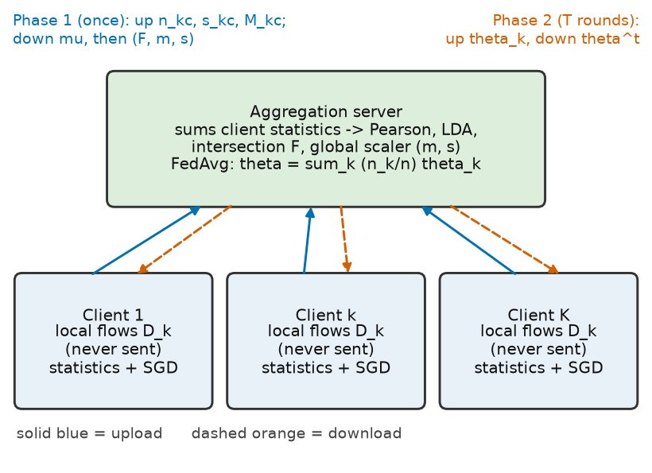

*Fig. 1. System architecture of FedStat-FS: clients never upload rows, only additive statistics (phase 1) and model parameters (phase 2).*

**Algorithm 1. FedStat-FS and federated linear detector**

“`
Require: client data $D_k$ (never sent; flowchart in Fig. 2, right), $\nu,\tau,k_L$, rounds $T$, local epochs $E$, step $\eta$, $\lambda$, $\mu_p$
Ensure: approximate minimiser $\theta_T$ of Eq. Eq. (1) and $(F,m,s)$
clients send $(n_{kc},s_{kc})$    // Eq. Eq. (2)
server: $n_c,\mu_c,\mu,p_1$; broadcast $\mu$    // Eq. Eq. (3)
clients send $M_{kc}$ around $\mu$    // Eq. Eq. (4)
server: $F_1,F_P,F_L$, $F=F_P\cap F_L$, $(m,s)$; broadcast    // Eqs. Eq. (?)}
$\theta^0\gets 0$
for {$t=0,\dots,T-1$}
each client: $z_i\gets(x_i[F]-m)/s$; run $E$ SGD epochs on $H_k(\cdot;\theta^t)$ from $\theta^t$
server: $\theta^{t+1}\gets\sum_k \tfrac{n_k}{n}\theta_k^{t+1}$    // Eq. Eq. (11)
end for
\Return $\theta_T,(F,m,s)$
“`
*Complexity.* Phase 1: client $O(n_kd^2)$ time, $O(d^2)$ memory; server $O(Kd^2+d^3)$. Phase 2 per round: client $O(En_k|F|)$, server $O(K|F|)$; model size $O(|F|)$.

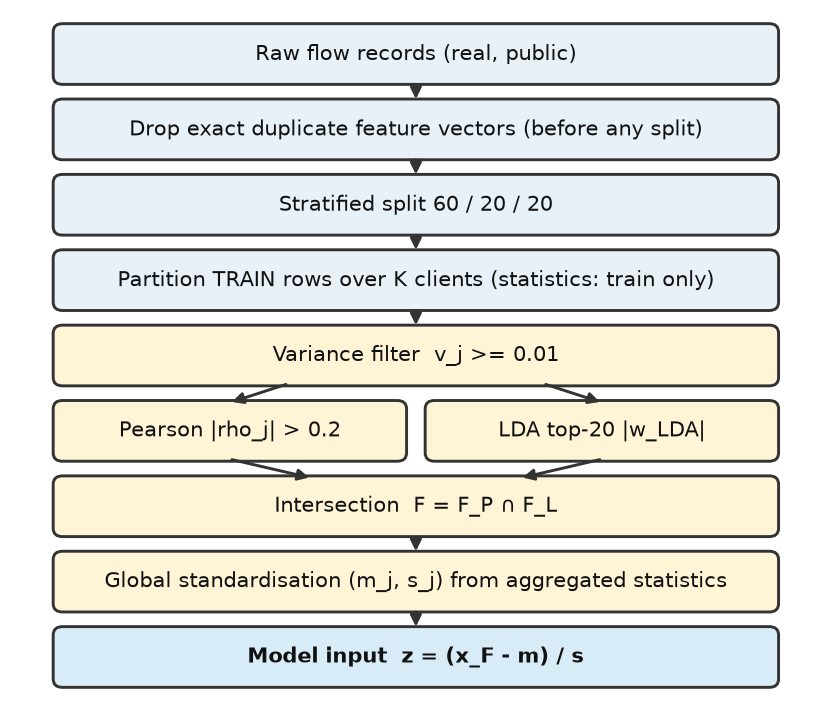
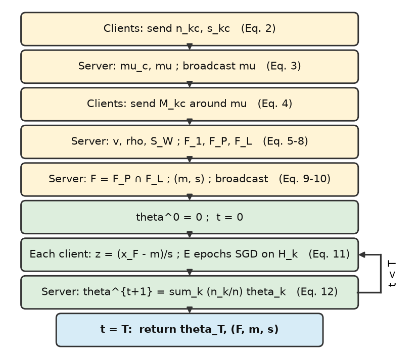

*Fig. 2. Left: preprocessing flowchart (de-duplication and splitting precede every statistic). Right: flowchart of Algorithm \ref{alg:main}.*

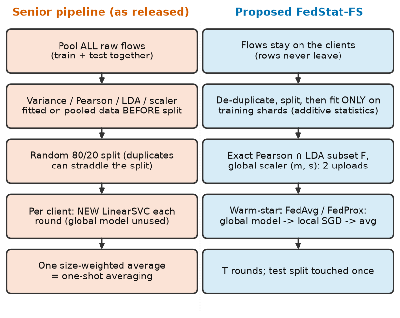

*Fig. 3. Senior pipeline as released versus FedStat-FS: what was changed.*

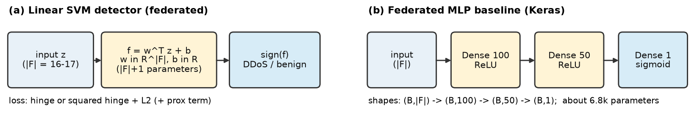

*Fig. 4. Detectors: the linear SVM used for federated averaging and the Keras MLP baseline (shapes and parameter counts).*

## Experimental Setup

**Data.** Both datasets are real, public and cited: CIC-IoT2023 [neto2023] (46 flow features; benign versus DDoS) and N-BaIoT [meidan2018] (115 features; benign versus Mirai/BASHLITE floods; scan classes excluded to stay in the DDoS scope). No synthetic data are used (Table II). Each dataset is reduced to a seeded random pool and *exact duplicate feature vectors are removed before any split* (37,799 of 809,836 CIC-IoT2023 and 72,225 of 300,000 N-BaIoT pool rows). A corpus is a seeded stratified sample split 60/20/20 into train, validation and test (Fig. 5).

**Table II.** Datasets (real, public). The pool is a seeded random sample of the release; exact duplicates are removed before any split; the corpus is a seeded stratified sample split 60/20/20.

| Dataset | Source / licence | Task / classes (release size) | Features | Pool rows | After de-dup | Corpus (seed 0) | Train/val/test | Clients |
|—|—|—|—|—|—|—|—|—|
| CIC-IoT2023 | unb.ca/cic (mirror: HF lacg030175/CIC-IoT-2023-neto-full; CC-BY-4.0) [neto2023] | benign vs 12 DDoS types (46.7M flows) | 46 | 809,836 | 772,037 | 200,000 (50% attack) | 120,005/39,995/40,000 | 10 |
| N-BaIoT | UCI id 442, doi:10.24432/C5RC8J; CC BY 4.0 [meidan2018] | benign vs 8 flood files (7.06M flows, 9 devices) | 115 | 300,000 | 227,775 | 136,939 (47% attack) | 82,189/27,368/27,382 | 9 |

**Clients.** CIC-IoT2023: $K{=}10$ clients with IID shards or Dirichlet label/attack-type skew [hsu2019], $\alpha\in\{1.0,0.3,0.1\}$, over the benign class and twelve DDoS types. N-BaIoT: $K{=}9$, one client per device (natural skew), plus an IID control. Validation and test rows follow each client's training proportions; metrics are pooled over clients.

**Methods.** *Central SVM/RF* [cortes1995; breiman2001] pool train-only preprocessed data. *Senior* is the released pipeline (preprocessing fitted on all rows; independent `LinearSVC` per client; one weighted average); *Senior (no leak)* fits it on training rows only. *Local-prep FedAvg* is the naive alternative: each client runs the senior filters on its own rows, features chosen by at least half of the clients are kept, and each client standardises with its own statistics. *FedStat-FS* is our method; *+FedProx* adds the proximal term; *FedAvg-MLP* trains a Keras 100-50 MLP on the same preprocessing. Ablations: A1 per-client scalers, A2 no selection (StatAvg-like), A3 one-shot cold-start averaging, A4 Pearson-only or LDA-only. All federated linear methods use $T{=}20$ rounds, $E{=}2$ local epochs, batch 64, step $\eta/(1+t)$; $\nu{=}0.01$, $\tau{=}0.2$, $k_L{=}20$ are shared.

**Fair tuning and statistics.** Every tuned method gets the same budget: random search, six trials from one random stream, scored by mean validation F1 over three corpora (seeds 0–2); the random forest uses its six-point grid. The test split is used once per run; final results use 10 seeds (0–9) that change sample, split, partition and initialisation. Differences are paired over seeds, with two-sided Wilcoxon signed-rank $p$ values Holm-corrected over 54 tests (smallest attainable raw $p$: 0.0020). Everything runs on CPU (Table III); TensorFlow trains every SGD-based detector.

**Table III.** Experimental setup (CPU only) and tuning search spaces. Tuned values per dataset/condition are in results/tables/tuned_hyperparameters.csv.

| Item | Setting |
|—|—|
| Platform | Windows 11 Home (build 10.0.26200), native; AMD Ryzen 7 7435HS (8 cores / 16 threads); 23.7 GB RAM; CPU only |
| Software | Python 3.11.9, TensorFlow 2.21.0 / Keras 3.15.1, scikit-learn 1.9.1, NumPy 2.4.6, SciPy 1.17.1 |
| Splits, seeds | 60/20/20 stratified; 10 seeds (corpus sample, split, partition, initialisation) |
| Preprocessing | variance $\ge$ 0.01; Pearson $|\rho|>0.2$; LDA top-20; intersection; standardisation |
| FL protocol | T = 20 rounds, E = 2 local epochs, batch 64, plain SGD, lr/(1+r) decay, all clients each round |
| Tuning (all methods) | random search, 6 trials, same random stream; objective = mean validation F1 over the corpora of seeds 0–2; test never used |
| Search space: SVM family | lr $\in$ [0.005, 0.3] (log), C $\in$ [0.3, 100] (log), loss $\in$ \{hinge, sq. hinge\}; FedProx: $\mu_p$ $\in$ [1e-3, 1] (log) |
| Search space: MLP / RF | MLP: lr $\in$ [0.005, 0.3], L2 $\in$ [1e-5, 1e-2] (log); RF: trees $\in$ \{50,100\} $\times$ depth $\in$ \{10,20,30\} (6-point grid) |
| Senior baseline search | sklearn LinearSVC: C $\in$ [0.3, 100] (log), loss $\in$ \{hinge, sq. hinge\}, max_iter 1000 |

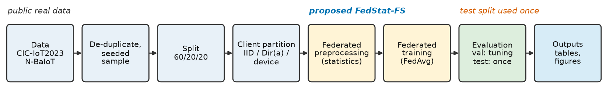

*Fig. 5. End-to-end pipeline: real public data are de-duplicated and split before any statistic is computed; validation drives tuning and the test split is used once.*

## Results

All values are test F1 (attack class, Eq. Eq. (12)), mean $\pm$ std over 10 seeds (780 runs); Table IV, Fig. 6, paired tests in Table VII.

**Table IV.** Test F1 (attack class), mean $\pm$ std over 10 seeds; best in bold. “Senior” fits preprocessing on all rows before the split; Central rows are not federated.

| Method | CIC IID | CIC Dir(1.0) | CIC Dir(0.3) | CIC Dir(0.1) | NBa Device | NBa IID |
|—|—|—|—|—|—|—|
| Central SVM | 0.9960 $\pm$ 0.0009 | 0.9960 $\pm$ 0.0009 | 0.9960 $\pm$ 0.0009 | 0.9960 $\pm$ 0.0009 | 0.9168 $\pm$ 0.1691 | 0.9169 $\pm$ 0.1669 |
| Central RF | **0.9987 $\pm$ 0.0002** | **0.9987 $\pm$ 0.0003** | **0.9988 $\pm$ 0.0002** | **0.9988 $\pm$ 0.0002** | **0.9997 $\pm$ 0.0003** | **0.9997 $\pm$ 0.0003** |
| Senior (as released) | 0.9963 $\pm$ 0.0008 | 0.9963 $\pm$ 0.0008 | 0.9951 $\pm$ 0.0010 | 0.9904 $\pm$ 0.0035 | 0.8704 $\pm$ 0.1660 | 0.8565 $\pm$ 0.1881 |
| Senior (no leak) | 0.9962 $\pm$ 0.0008 | 0.9958 $\pm$ 0.0009 | 0.9952 $\pm$ 0.0009 | 0.9892 $\pm$ 0.0049 | 0.9226 $\pm$ 0.1562 | 0.9252 $\pm$ 0.1537 |
| Local-prep FedAvg | 0.9953 $\pm$ 0.0010 | 0.9388 $\pm$ 0.0330 | 0.7663 $\pm$ 0.1181 | 0.5754 $\pm$ 0.1963 | 0.6231 $\pm$ 0.0905 | 0.9987 $\pm$ 0.0002 |
| FedStat-FS (proposed) | 0.9946 $\pm$ 0.0029 | 0.9942 $\pm$ 0.0026 | 0.9918 $\pm$ 0.0037 | 0.9913 $\pm$ 0.0035 | 0.9264 $\pm$ 0.1505 | 0.9065 $\pm$ 0.1928 |
| FedStat-FS + FedProx | 0.9904 $\pm$ 0.0044 | 0.9897 $\pm$ 0.0035 | 0.9890 $\pm$ 0.0028 | 0.9895 $\pm$ 0.0032 | 0.9263 $\pm$ 0.1506 | 0.9282 $\pm$ 0.1468 |
| FedAvg-MLP (fed. prep) | 0.9961 $\pm$ 0.0009 | 0.9962 $\pm$ 0.0010 | 0.9961 $\pm$ 0.0009 | 0.9959 $\pm$ 0.0009 | 0.9730 $\pm$ 0.0509 | 0.9806 $\pm$ 0.0359 |

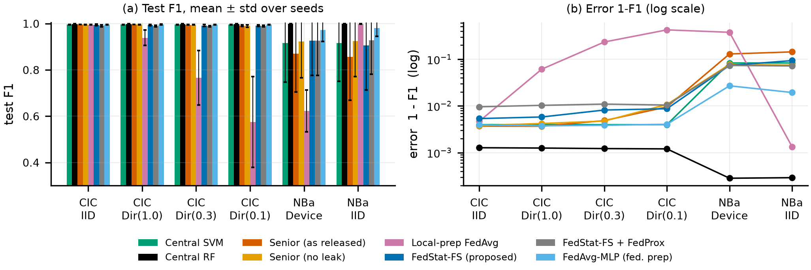

*Fig. 6. Test F1 of all methods under every client regime (a) and the same means as error $1-F_1$ on a log scale (b). Error bars: std over seeds. NBa = N-BaIoT.*

**RQ1: fidelity and leakage.** In all 60 of 60 FedStat-FS runs the subset computed from client statistics was identical to the pooled training-only subset (Jaccard 1.000), and equal to that of *Senior (no leak)* in 60/60 paired comparisons: the federated preprocessing is exact, also under the strongest skew. Fitting preprocessing on all rows (Senior) instead of training rows changed CIC-IoT2023 F1 by +0.0001 at IID ($p=$ 0.461) and +0.0012 at Dir(0.1) ($p=$ 0.375); on N-BaIoT the leaky variant is *worse* (-0.0522), plausibly because pooling all rows changes the selected subset. *Answer: exact, and no measurable leakage optimism here (the pooled protocol stays privacy-inconsistent regardless).*

**RQ2: heterogeneity.** Under IID clients all federated pipelines coincide (CIC-IoT2023: Local-prep 0.9953, FedStat-FS 0.9946). As skew grows, naive local preprocessing degrades to 0.9388, 0.7663 and 0.5754 at Dir(1.0/0.3/0.1) (F1 $<0.9$ in 10 of 10 Dir(0.1) runs), whereas FedStat-FS holds 0.9942, 0.9918 and 0.9913; on the natural per-device federation the gap is 0.6231 versus 0.9264. At Dir(0.1), $\Delta F_1=$ +0.4159 (95% CI [+0.2762, +0.5556]; raw $p=$ 0.002, the floor for 10 seeds, so every seed favours FedStat-FS; Holm over all tests 0.105; post hoc, Holm within this comparison's six regimes 0.012): large and consistent, but significant only under the less conservative family.

The ablations (Table V, Fig. 7) locate the cause. Federated selection with per-client *scaling* (A1) is even worse than Local-prep (Dir(0.1): 0.3552): clients with different traffic mixes learn weights in different coordinate systems that cannot be averaged. Local voting also selects other features (Jaccard 0.87 at IID, 0.41 at Dir(0.1), 0.19 on devices; Fig. 7). One-shot cold-start averaging (A3) costs $\Delta F_1=$ +0.0107 at Dir(0.1) (raw $p=$ 0.027, Holm 0.820), a mild trend only. *Answer: a common standardiser from shared statistics is what keeps a federated linear detector usable under non-IID clients.*

**Table V.** Ablations (test F1, mean $\pm$ std): A1 per-client scalers; A2 no selection; A3 one-shot averaging; A4 Pearson-only / LDA-only. A1 and A3 inherit the tuned FedStat-FS hyper-parameters; A2 and A4 are tuned separately.

| Method | CIC IID | CIC Dir(1.0) | CIC Dir(0.3) | CIC Dir(0.1) | NBa Device | NBa IID | #feat (CIC / NBa) |
|—|—|—|—|—|—|—|—|
| FedStat-FS (proposed) | 0.9946 $\pm$ 0.0029 | 0.9942 $\pm$ 0.0026 | 0.9918 $\pm$ 0.0037 | 0.9913 $\pm$ 0.0035 | 0.9264 $\pm$ 0.1505 | 0.9065 $\pm$ 0.1928 | 16 / 16 |
| A1: local scalers | 0.9946 $\pm$ 0.0029 | 0.9189 $\pm$ 0.0490 | 0.6417 $\pm$ 0.0927 | 0.3552 $\pm$ 0.2722 | 0.9514 $\pm$ 0.0965 | 0.9080 $\pm$ 0.1897 | 16 / 16 |
| A2: no selection | **0.9969 $\pm$ 0.0002** | **0.9971 $\pm$ 0.0003** | 0.9954 $\pm$ 0.0016 | 0.9934 $\pm$ 0.0022 | **0.9997 $\pm$ 0.0001** | **0.9997 $\pm$ 0.0001** | 34 / 111 |
| A3: one-shot averaging | 0.9943 $\pm$ 0.0038 | 0.9927 $\pm$ 0.0075 | 0.9934 $\pm$ 0.0027 | 0.9806 $\pm$ 0.0201 | 0.9569 $\pm$ 0.0834 | 0.9087 $\pm$ 0.1880 | 16 / 16 |
| A4a: Pearson only | 0.9967 $\pm$ 0.0005 | 0.9968 $\pm$ 0.0004 | **0.9965 $\pm$ 0.0010** | **0.9936 $\pm$ 0.0037** | 0.9993 $\pm$ 0.0002 | 0.9995 $\pm$ 0.0001 | 23 / 59 |
| A4b: LDA only | 0.9965 $\pm$ 0.0003 | 0.9955 $\pm$ 0.0014 | 0.9946 $\pm$ 0.0013 | **0.9936 $\pm$ 0.0020** | 0.9283 $\pm$ 0.1464 | 0.9103 $\pm$ 0.1851 | 20 / 20 |

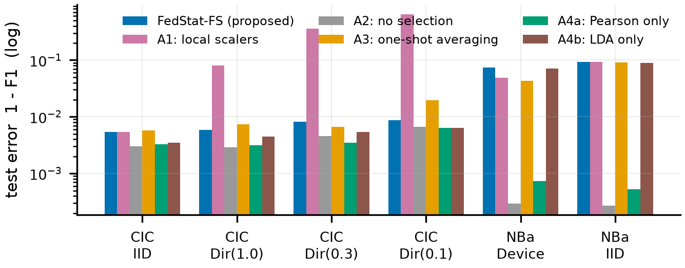
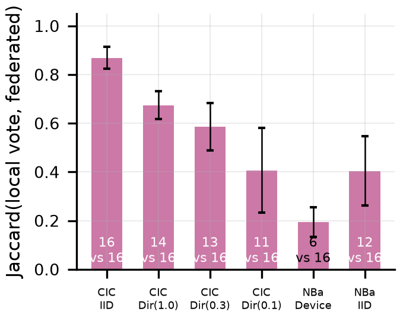

*Fig. 7. Left: ablation of the new components as test error $1-F_1$ (log scale; A1 per-client scalers, A2 no selection, A3 one-shot averaging, A4 Pearson-only / LDA-only). Right: agreement (Jaccard) between the locally voted and the federated feature subsets; numbers in bars: subset sizes (local vs federated).*

**Selection is not the beneficial part.** The Pearson–LDA intersection did not improve accuracy. On CIC-IoT2023, no selection (34 features) and Pearson-only reach 0.9969 and 0.9967 at IID versus 0.9946 for the 16-feature intersection ($\Delta F_1=$ -0.0023, raw $p=$ 0.002, Holm 0.105): compression halves the input at a small accuracy price. On N-BaIoT it is *unstable*: every linear model that uses it fails (F1 $<0.9$) on the same seeds (FedStat-FS 4/20 runs, Central SVM 4, Senior no leak 4; Senior, whose all-row fit picks other subsets, 8), while Pearson-only, no selection and the random forest never fail (0, 0). This is a property of the rule, not of federation: exact solvers on the pooled *training* split reach F1 0.630 with the 19-feature subset of a failing seed, versus 1.000 with Pearson-only and 1.000 with all features.
**RQ3: cost and competitiveness.** The linear detector has 17 parameters, trains in 4.8 s and classifies 1000 flows in 0.01 ms, against 6,801 parameters, 31.3 s and 16.38 ms for the federated MLP (Table VI). The one-off statistics upload is 33.8 KB per client for 46 features (208.5 KB for 115): more than the *whole* model traffic of the linear detector (27.0 KB over all rounds and clients) but far below the MLP's. FedStat-FS is slightly below the centralised SVM ($\Delta F_1=$ -0.0014 at CIC IID, raw $p=$ 0.002, Holm 0.105); the federated MLP matches it (0.9961) and the pooled forest is the ceiling (0.9987). FedProx did not help (0.9895 against 0.9913 at Dir(0.1)), as expected when drift comes from scaling. *Answer: the extra communication is small and one-off; the linear detector classifies two to three orders of magnitude faster than the MLP or forest, at 0.14–0.47 F1 points below the MLP on CIC-IoT2023.*

**Table VI.** Computational cost on CPU (CIC-IoT2023, seed 0, IID clients; whole simulated federation on one machine; cold run in a fresh process, median of three; the RAM column is noisy, roughly $\pm$100 MB, and dominated by data copies). Traffic counts float32 model up/down-loads over all rounds; the statistics upload is float64, once.

| Method | Train (s) | Preproc. (s) | Inference (ms/1k flows) | Parameters | Peak extra RAM (MB) | Model traffic (KB, whole run) | Stats upload (KB/client) |
|—|—|—|—|—|—|—|—|
| Central SVM | 2.1 | 0.11 | 0.01 | 17 | 176 | 0.0 | 0.0 |
| Central RF | 2.3 | 0.14 | 3.87 | 28,880 | 175 | 0.0 | 0.0 |
| Senior (as released) | 0.5 | 0.23 | 0.01 | 17 | 296 | 2.0 | 0.0 |
| FedStat-FS (proposed) | 4.8 | 0.1 | 0.01 | 17 | 175 | 26.6 | 33.8 |
| FedStat-FS + FedProx | 4.8 | 0.13 | 0.01 | 17 | 85 | 26.6 | 33.8 |
| FedAvg-MLP (fed. prep) | 31.3 | 0.09 | 16.38 | 6,801 | 122 | 10626.6 | 33.8 |

**Training, sensitivity and errors.** Fig. 8 shows convergence within a few rounds under IID and device clients and more slowly under Dir(0.1) (validation loss still falling at round 20; the local training loss rises as local models stop over-fitting their own classes). In the sensitivity study (validation, CIC Dir(0.3), Fig. 9) FedStat-FS varies between 0.9749 and 0.9953 over $\tau$ (best at $\tau=0.1$: more features), rises with the LDA budget from 0.9546 to 0.9968 and is flat in rounds; no setting rescues Local-prep (best 0.8574). Errors (Fig. 9, 8) concentrate in the rarest classes: SlowLoris and HTTP flood are missed by all four methods including the forest, fragmentation floods are also hard for linear detectors, and Local-prep additionally misclassifies the large flood classes and, on N-BaIoT, confuses junk and combo floods with benign traffic.

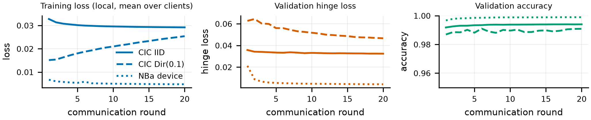
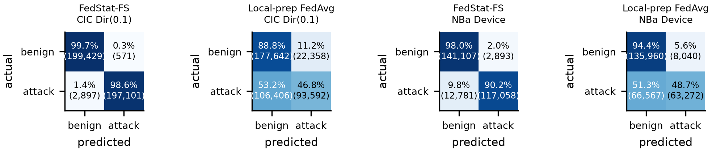

*Fig. 8. Top: convergence of FedStat-FS (seed 0): local training loss, validation hinge loss and validation accuracy per round. Bottom: confusion matrices (summed over seeds, row-normalised, counts in brackets) for FedStat-FS and Local-prep FedAvg under CIC Dir(0.1) and N-BaIoT device clients.*

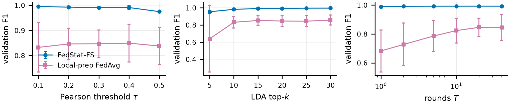
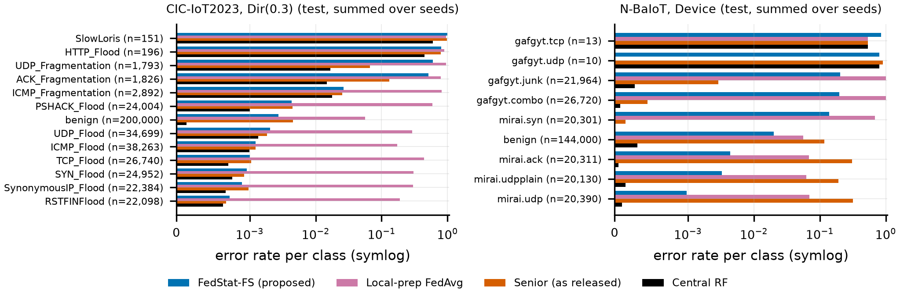

*Fig. 9. Top: validation F1 versus Pearson threshold $\tau$, LDA top-$k_L$ and rounds $T$ (CIC Dir(0.3), 5 seeds). Bottom: per-class test error rate (symlog axis), summed over seeds, with class sizes.*

**Table VII.** Paired tests over 10 seeds (test F1): $\Delta$F1 = A $-$ B; $p$ = Wilcoxon signed-rank, raw / Holm over all 54 tests (full list with intervals in the CSV; smallest attainable $p$ = 0.0020).

| Comparison (A vs B) | CIC IID: $\Delta$F1 | CIC IID: $p$ / Holm | CIC Dir(0.1): $\Delta$F1 | CIC Dir(0.1): $p$ / Holm | N-B Device: $\Delta$F1 | N-B Device: $p$ / Holm |
|—|—|—|—|—|—|—|
| Senior (as released) vs Senior (no leak) | 0.0001 | 0.461/1.000 | 0.0012 | 0.375/1.000 | -0.0522 | 0.625/1.000 |
| FedStat-FS (proposed) vs Local-prep FedAvg | -0.0007 | 0.695/1.000 | 0.4159 | 0.002/0.105 | 0.3032 | 0.010/0.312 |
| FedStat-FS (proposed) vs A2: no selection | -0.0023 | 0.002/0.105 | -0.0021 | 0.049/1.000 | -0.0733 | 0.002/0.105 |
| FedStat-FS (proposed) vs A3: one-shot averaging | 0.0004 | 0.625/1.000 | 0.0107 | 0.027/0.820 | -0.0305 | 0.432/1.000 |
| FedStat-FS (proposed) vs Central SVM | -0.0014 | 0.002/0.105 | -0.0047 | 0.002/0.105 | 0.0095 | 1.000/1.000 |
| FedStat-FS (proposed) vs Senior (as released) | -0.0017 | 0.002/0.105 | 0.0008 | 0.432/1.000 | 0.056 | 1.000/1.000 |
| FedStat-FS (proposed) vs FedAvg-MLP (fed. prep) | -0.0014 | 0.002/0.105 | -0.0047 | 0.004/0.141 | -0.0466 | 0.432/1.000 |

## Discussion

**What the evidence supports.** Federated preprocessing is exact and its leakage-free protocol costs no accuracy (RQ1); under non-IID clients the decisive ingredient is a *common* standardiser, which extends the StatAvg finding [bouzinis2025] to a linear pipeline and shows per-client scaling to be more damaging than per-client selection (RQ2); the price is a one-off upload and a small gap to the centralised SVM (RQ3). Exactness is an algebraic identity, so our runs check the implementation and its numerical stability rather than discover it; and because A2 is StatAvg-like, the added value over StatAvg is the audited exact selection, whose benefit we could not show.
**Consequences for the senior claims.** Federated–centralised parity holds only approximately, and was obtained with pooled preprocessing. The claim that the Pearson–LDA intersection is “optimal” [senior2026] is not supported: on CIC-IoT2023 it trades a little accuracy for half the input width, and on N-BaIoT it can leave a linear detector unable to separate the classes. Practically: standardise with shared statistics; prefer Pearson-only selection or none unless a sufficiency check (computable from the same aggregated matrices) passes; fit every statistic on training data only; de-duplicate before splitting. The upload holds class-conditional means and covariances, which are not private; secure aggregation [bonawitz2017] or noise would be needed (not evaluated).

### Threats to Validity and Limitations

**Internal.** Hyper-parameters were chosen on validation splits of corpora 0–2, whose pool rows can reappear in other seeds' test splits (all corpora share one de-duplicated pool); with six candidates per method the optimism is negligible but not zero. A failure is a run with test F1 $<0.9$ (descriptive). The federation is simulated on one machine, so timings exclude communication. **External.** Two testbed datasets, binary tasks, 9–10 clients; Dirichlet partitions are synthetic *partitions* of real flows, the N-BaIoT device split is natural. **Construct.** Privacy is argued structurally and not measured (no secure aggregation or differential privacy); “leakage” is judged only by the performance gap, which selection variability confounds. **Limitations.** The CPU budget fixed 20 rounds, 2 local epochs, six tuning trials and the corpus sizes of Table II for all methods; the pseudo-inverse of $S_W$ costs $O(d^3)$ at the server (negligible for $d\le115$); stragglers, malicious clients and multi-class typing were not studied; the pooled forest is a non-federated ceiling, not a competitor.

## Conclusion and Future Work

We audited a federated linear DDoS pipeline, showed that its preprocessing is pooled and pre-split, and replaced it with FedStat-FS, an exact federated computation of variance filtering, Pearson and LDA selection and standardisation from two additive uploads per client. On two real datasets, global standardisation kept federated linear detection usable under strong non-IID skew where naive local preprocessing failed; the leakage of the original protocol was not measurable, and the hybrid intersection was neither more accurate nor stable. Future work: a federated sufficiency check for selected subsets, secure aggregation for the statistics, and multi-class typing.

**Data Availability Statement.** All data are real and public. CIC-IoT2023 is distributed by the Canadian Institute for Cybersecurity (<https://www.unb.ca/cic/datasets/iotdataset-2023.html>); we used the Hugging Face mirror `lacg030175/CIC-IoT-2023-neto-full` (declared CC-BY-4.0) after verifying its class counts against the release [neto2023]. N-BaIoT is on the UCI repository (id 442, doi:10.24432/C5RC8J, CC BY 4.0) [meidan2018]. Download scripts, raw per-run results and tuned hyper-parameters accompany the paper.

**Code Availability Statement.** All code (including the unchanged senior code and its outputs) can be re-run with `python code/run_all.py` in a fresh virtual environment built from `requirements.txt`. Public repository: [URL to be added by the authors].

**Ethics Statement.** Only public, anonymised network-flow feature records from laboratory testbeds were used; no human subjects, personal data or live systems were involved and no attack traffic was generated. The methods are defensive; failure cases are reported (Section the referenced section).

**Conflict of Interest.** [The authors declare no competing interests – to be confirmed by the authors.] **Funding.** [Funding sources and grant numbers to be completed by the authors.]

**CRediT Author Contributions.** [Author 1]: Conceptualization, Methodology, Supervision, Writing – review & editing. [Author 2]: Software, Investigation, Validation, Formal analysis, Data curation, Visualization, Writing – original draft. [Author 3]: Resources, Project administration, Funding acquisition. (Placeholders to be assigned by the authors per the CRediT taxonomy.)

**AI-use Disclosure.** An AI coding and writing assistant (Anthropic Claude, model “Claude Sonnet 5”, run through Claude Code) was used autonomously, under the authors' instructions, to audit and port the senior code, implement and run all experiments, verify references against Crossref and arXiv, generate tables and figures, and draft this manuscript. All numerical results come from executed code with archived logs; every reference was checked to exist. The human authors are responsible for the content and must review the text, the claims and the placeholders before submission.
}

## References

1. **[mcmahan2017]** McMahan, H. Brendan, Moore, Eider, Ramage, Daniel, Hampson, Seth, Arcas, Blaise Agüera y, “Communication-Efficient Learning of Deep Networks from Decentralized Data,” *Proc. 20th Int. Conf. Artificial Intelligence and Statistics (AISTATS)*, 2017.
2. **[kairouz2021]** Kairouz, Peter, McMahan, H. Brendan, “Advances and Open Problems in Federated Learning,” *Foundations and Trends® in Machine Learning*, 2021. doi:10.1561/2200000083
3. **[karunamurthy2025]** Karunamurthy, A., Vijayan, K., Kshirsagar, Pravin R., Tan, Kuan Tak, “An optimal federated learning-based intrusion detection for IoT environment,” *Scientific Reports*, 2025. doi:10.1038/s41598-025-93501-8
4. **[cortes1995]** Cortes, Corinna, Vapnik, Vladimir, “Support-vector networks,” *Machine Learning*, 1995. doi:10.1007/bf00994018
5. **[senior2026]** Mohamed C P, Haris, Kundu, Anindita, “Privacy-Preserving Federated Learning Framework for DDoS Attack Detection in IoT Networks Using Hybrid Feature Selection,” *Manuscript submitted to IEEE Access (senior paper supplied with this project; no DOI available)*, 2026.
6. **[bouzinis2025]** Bouzinis, Pavlos S., others, “StatAvg: Mitigating Data Heterogeneity in Federated Learning for Intrusion Detection Systems,” *IEEE Transactions on Network and Service Management*, 2025. doi:10.1109/tnsm.2025.3564387
7. **[nguyen2026]** Nguyen, Thien D., Alazab, Ammar, Khraisat, Ansam, Jan, Tony, “Feature reduction in federated learning for intrusion detection in IoT networks,” *Cybersecurity*, 2026. doi:10.1186/s42400-025-00509-8
8. **[fdids2025]** Peng, Haonan, Wu, Chunming, Xiao, Yanfeng, “FD-IDS: Federated Learning with Knowledge Distillation for Intrusion Detection in Non-IID IoT Environments,” *Sensors*, 2025. doi:10.3390/s25144309
9. **[agrawal2022]** Agrawal, Shaashwat, others, “Federated Learning for intrusion detection system: Concepts, challenges and future directions,” *Computer Communications*, 2022. doi:10.1016/j.comcom.2022.09.012
10. **[doriguzzi2024]** Doriguzzi-Corin, Roberto, Siracusa, Domenico, “FLAD: Adaptive Federated Learning for DDoS attack detection,” *Computers \& Security*, 2024. doi:10.1016/j.cose.2023.103597
11. **[devine2025]** Devine, Mark, Ardakani, Saeid Pourroostaei, Al-Khafajiy, Mohammed, James, Yvonne, “Federated Machine Learning to Enable Intrusion Detection Systems in IoT Networks,” *Electronics*, 2025. doi:10.3390/electronics14061176
12. **[hsu2019]** Hsu, Tzu-Ming Harry, Qi, Hang, Brown, Matthew, “Measuring the Effects of Non-Identical Data Distribution for Federated Visual Classification,” *arXiv:1909.06335*, 2019.
13. **[li2020fedprox]** Li, Tian, Sahu, Anit Kumar, Zaheer, Manzil, Sanjabi, Maziar, Talwalkar, Ameet, Smith, Virginia, “Federated Optimization in Heterogeneous Networks,” *Proc. Machine Learning and Systems (MLSys)*, 2020.
14. **[datasetcentric2026]** Bilal, Muhammad Ahmad, Ul Islam, Ihtesham, Idrees, Sarmad, Qasim, Muhammad, Khan, Muhammad Junaid, Khan, Jaleed, “Dataset-centric evaluation of federated intrusion detection models in IoT networks,” *Scientific Reports*, 2026. doi:10.1038/s41598-025-32567-w
15. **[ambusaidi2016]** Ambusaidi, Mohammed A., He, Xiangjian, Nanda, Priyadarsi, Tan, Zhiyuan, “Building an Intrusion Detection System Using a Filter-Based Feature Selection Algorithm,” *IEEE Transactions on Computers*, 2016. doi:10.1109/tc.2016.2519914
16. **[yang2021]** Yang, Qin, Kondo, Masaaki, “Federated Learning-Based Network Intrusion Detection with a Feature Selection Approach,” *2021 International Conference on Electrical, Communication, and Computer Engineering (ICECCE)*, 2021. doi:10.1109/icecce52056.2021.9514222
17. **[arp2022]** Arp, Daniel, others, “Dos and Don'ts of Machine Learning in Computer Security,” *Proc. 31st USENIX Security Symposium*, 2022.
18. **[kapoor2023]** Kapoor, Sayash, Narayanan, Arvind, “Leakage and the reproducibility crisis in machine-learning-based science,” *Patterns*, 2023. doi:10.1016/j.patter.2023.100804
19. **[neto2023]** Neto, Euclides Carlos Pinto, Dadkhah, Sajjad, Ferreira, Raphael, Zohourian, Alireza, Lu, Rongxing, Ghorbani, Ali A., “CICIoT2023: A Real-Time Dataset and Benchmark for Large-Scale Attacks in IoT Environment,” *Sensors*, 2023. doi:10.3390/s23135941
20. **[meidan2018]** Meidan, Yair, others, “N-BaIoT—Network-Based Detection of IoT Botnet Attacks Using Deep Autoencoders,” *IEEE Pervasive Computing*, 2018. doi:10.1109/mprv.2018.03367731
21. **[breiman2001]** Breiman, Leo, “Random Forests,” *Machine Learning*, 2001. doi:10.1023/a:1010933404324
22. **[bonawitz2017]** Bonawitz, Keith, others, “Practical Secure Aggregation for Privacy-Preserving Machine Learning,” *Proceedings of the 2017 ACM SIGSAC Conference on Computer and Communications Security*, 2017. doi:10.1145/3133956.3133982}
\end{document}
